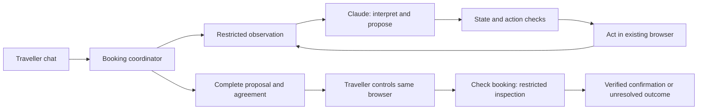
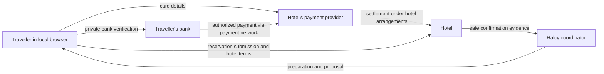

# Architecture and design decisions

Decision baseline updated: 2026-10-06. This document covers the agreed first and second stages; its original filename is retained for existing references. It describes intended behaviour, not a claim that every capability is implemented or tested. Read [BRIEF.md](../BRIEF.md), [README.md](../README.md), and [AGENTS.md](../AGENTS.md) for the assignment, runtime, and repository constraints. Detailed component contracts and diagrams are in [system-design.md](system-design.md); interactions and recovery are in [booking-journey.md](booking-journey.md). Model research is in [model-selection-spike.md](model-selection-spike.md), and the submission narrative starts in [design-document-draft.md](design-document-draft.md).

Implementation assignments, environment readiness, agent coordination, and unfinished work belong in a separate temporary handoff, not this document.

## Design rationale

| Decision | Reason |
| --- | --- |
| Traveller chat is the entry point | The booking is part of the group conversation; the browser is a tool used within that journey. |
| Direct Claude, one configurable model initially | Uses the existing API account, establishes a measurable baseline, and keeps integration small. Additional models need evidence of better results or cost. |
| A coordinator owns state and permission | Model suggestions can be wrong; approval, control ownership, and recovery cannot depend on conversational memory alone. |
| Runtime learns from visible hotel pages | The product must work on sites it has not seen, without mock-specific selectors or hidden endpoints. |
| Human performs every binding submission | The commitment boundary also applies to pay-later and card-guarantee reservations. |
| Blind handoff in the same local browser | Keeps sensitive input outside observations and preserves the session required to finish the booking. |
| Explicit Check booking action | The website has no universal completion signal, and the user controls when restricted inspection resumes. |
| Search replacements automatically; require fresh agreement | Reduces recovery delay while preserving informed choice when the actual offer changes. |
| Keep observed alternatives as provisional candidates | Reuses existing work without treating stale price or availability as a promise. |
| Traveller chooses initial and replacement offers | A recommendation should not silently select the room/rate. |
| Near-miss exceptions apply to one chosen offer | Allows an informed compromise without weakening the original search requirements. |
| Infer conventional preparation from visible context | Avoids unnecessary handoffs when an ordinary continuation lacks an explicit no-obligation statement; this accepts residual risk on poorly labelled sites. |
| Keep chat open during private checkout | Questions can use the reviewed quote without restoring browser access. Changes require a submission-status decision. |
| Let room holds expire | Avoids surprising background renewals or disturbing a checkout the user might already have completed. |
| An unresolved outcome is a valid stopping state | A timeout can hide a successful booking or payment; repeating it could create another commitment. |

## Runtime placement

For the MVP, the chat server, coordinator, Playwright controller, and visible Chromium browser run locally. Claude runs through Anthropic's API and receives the request plus restricted textual observations and structured state. The chat browser and controlled hotel browser are separate windows. The mock hotel and mock payment provider remain separate services/origins.

The model's only browser capability is to propose actions against the latest permitted observation. The application executes those proposals. The API key stays server-side; it is never sent to the chat frontend, hotel, or run log. A future hosted browser would require a new review of the sensitive-data path.

## Components and data flow

The traveller starts in the existing chat. A TypeScript booking coordinator owns a single run, browser session, structured booking state, and the current control owner. A configurable Claude model interprets requests and proposes browser actions through the existing model seam. Application code validates each proposal before passing it to observe/act. The model never receives unrestricted Playwright access.

Use separate schemas/prompts for request interpretation and the browser loop, but one configured model initially. The chosen provider is direct Claude; the initial model is configurable with `claude-sonnet-5-5` as the baseline. Do not silently switch models. Use environment configuration, bounded calls, and usage logging. Model selection is not a payment safeguard.

The coordinator maintains distinct records for the current request and revision, observed offers with evidence and timestamps, the proposed complete quote, the explicitly approved quote version, browser control ownership, submission uncertainty, and confirmation evidence. Progress events and cards are views of these records. A cached candidate, a proposal, an approved offer, and a confirmed booking must never be interchangeable states.

## Request and offer state

The request records hotel, explicit dates, occupancy, hard requirements, soft preferences, exclusions, and unknowns. Constraints come from the current request: refundable cancellation is not a global requirement. River view may be a preference, while dates and capacity are requirements. Resolve relative dates against supplied current date and display absolute dates in proposals.

Use group participant count when available and assume a shared stay. Explicit occupancy overrides group count. The starter lacks group metadata, so support an optional count and otherwise clarify. A bare numerical answer means adults. Ask ages only when children are included and the hotel's journey requires them. Use the saved traveller profile as lead guest. Do not silently invent missing required details or split the party across rooms.

Keep room/rate facts with supporting visible-page evidence and an established/inferred/unknown distinction. Hotel-level descriptions do not prove room-level amenities. Inspect additional visible details when a hard requirement is unknown; do not silently treat missing information as satisfied.

Keep observed alternatives and relevant upsells in a per-run snapshot. Do not crawl extra upsells merely to populate a cache. Cached availability and prices are provisional. Initial room/rate options are shown for an explicit traveller choice, ranked by evidenced preference fit and comparable price. Known hard conflicts are excluded from eligible choices; unknown facts remain labelled. When no eligible option is verified, show near misses with every known conflict and unverified constraint. An option-specific confirmation accepts only known conflicts for that offer and request revision; unknown requirements remain active until checkout proves them, and a newly established conflict needs a new decision. It does not approve the final quote. Candidate budget comparisons normalize nightly and stay prices; missing mandatory costs cannot prove a budget match. When a room becomes unavailable, show eligible saved alternatives by absolute distance from the original comparable price. If none were saved, announce and begin a new search. Revalidate the chosen alternative before agreement. Unknown or incomparable totals receive no numeric distance rank.

Basic cards suffice for the first slice. When a proposal becomes unavailable, preserve it as history, mark it unavailable, disable its old actions, and show alternatives with select, edit-search, and stop controls. The functional behavior is part of the design; a carousel and polished error communication are deferred to later research. Search revisions prevent late responses and old approvals from applying to new criteria.

## Preparation, agreement, and final submission

The agent may fill ordinary guest details and use a conventional “Continue to payment” step when the visible context gives no indication that the action confirms a reservation, charges or authorises payment, or accepts binding terms. This is an approved contextual inference for the prototype, not proof that every hotel discloses its obligations clearly. An action-specific “no reservation until you continue to payment” warning identifies that button as the boundary and blocks the click. An automatically expiring inventory hold without financial obligation is preparatory; a card authorisation hold is a payment action and remains private. Cancellation penalties on a rate and pay-at-hotel timing do not alone make the guest-details action binding. Conflicting context or an unidentified action leads to inspection or handoff. The mock reveals tax and potential repricing after guest details, so the final quote is checked there. Runtime decisions come from visible pages, never mock source or admin endpoints.

Remember recent actions as short semantic descriptions with the observed result and a sanitized failure category. Do not include form values or old control IDs. Stop on repeated no-change actions and on short action cycles, including cycles that visibly change the page but return to an earlier state. Date handling uses the current observation: fill an unambiguous editable date field with the requested ISO date, select a unique currently visible matching date option through the guarded action interface, and re-observe after each action. Respect disabled dates; leave ambiguous calendars to the model or traveller. Never force a DOM value or rely on a mock-specific selector.

Bind material offer facts to their visible sources. Record which room/rate selection was made. The room, rate, and cancellation evidence must be exact excerpts from that selected offer; current dates, occupancy, tax, and payment amounts must be evidenced on the quote page. Reject missing, contradictory, or other-rate evidence. A general excerpt somewhere in the browsing history does not prove a selected rate's terms. Evidence must support the claim, not merely occur in the source: preserve the complete applicable cancellation deadline and penalties even if the model selects a shorter excerpt; check the guarantee claim against its evidence; distinguish “non-refundable” from “refundable”.

Before agreement, present the actual room/rate, dates, occupancy, inclusions, cancellation deadline/penalties as disclosed, full total and currency including mandatory taxes, amounts payable now/later, guarantee obligations, and the hotel/payment recipient. Preserve hotel wording when precise deadlines cannot be derived safely. Unknown mandatory costs prevent presenting a complete quote.

Bind agreement to a versioned snapshot of these material terms. Changes invalidate approval and require a complete fresh proposal identifying the change. Preserve selected-rate evidence across quote re-observation. Agreement to a proposal is not evidence of payment or a reservation. The traveller always performs the final reservation submission, even where no immediate payment or card is required. The agent must stop before a potentially binding step whose consequences it cannot establish.

## Private handoff and observation boundary

Use the same local, visible Chromium window that the agent has driven. A checkout link opened in another browser does not preserve the required session. Show the traveller how to use that existing window and return to chat.

Switch control ownership before inviting the traveller to enter sensitive information. While the traveller owns the browser, make no observations, screenshots, recordings, model calls about browser content, or browser actions. The user explicitly selects Check booking to request restricted inspection; this never grants unrestricted observation or permission to submit.

Replace the starter's raw all-frame observer: exclude sensitive surfaces before extracting their text or values. Never pass unrestricted observations to a later redactor. For the first slice, conservatively exclude subframes and foreign-origin pages, and stop on sensitive main-frame forms or uncertain boundaries; document unsupported embedded hotel engines rather than read arbitrary frames. Do not capture raw screenshots of sensitive or uncertain pages. Browser traces, network bodies, console output, query secrets, and error dumps must not become alternate routes into logs. No runtime access to bank-code sources or payment-provider APIs.

The same restrictions apply after handback. A new tab, changed URL, or absence of an iframe does not prove that inspection is safe. Keep excluded surfaces excluded. If no safe hotel confirmation can be isolated, stop with an unresolved outcome. Generic classification is imperfect; document the prototype's coverage and do not claim guaranteed isolation on every possible site.

Login, CAPTCHA, account verification, passwords, and ID uploads should eventually use the same private handoff. They are documented future scope, not required first-pass implementation. Ordinary guest contact fields remain within the agent's preparation role.

## Confirmation and recovery

Conceptual coordinator states: clarifying, searching, awaiting-selection, awaiting-exception, preparing, awaiting-agreement, traveller-control, verifying, confirmed, unavailable, outcome-unknown, stopped. These are design states, not a required enum or claim about current code. Track the exact request and approved quote separately from a cached candidate list. After handoff, conservatively assume a submission may have occurred until the outcome is established.

The main path is clarification → search → traveller selection → preparation → (traveller-controlled advance when a preparatory action is uncertain) → complete-quote agreement → traveller control → restricted verification → confirmation. A selected near miss adds an explicit exception decision before preparation. Unavailability before commitment returns to saved alternatives or a new search, followed by traveller selection. Changed terms return to agreement with a new complete quote. Verification with insufficient evidence enters outcome-unknown, which has no automatic transition to another booking attempt. An action error consumes its observation IDs even if the browser result is uncertain.

The normal outcome is a hotel confirmation with a labelled reference and visible room, dates, and total matching the approved stay. The verifier uses only the safe main-document observation and checks those fields locally; it does not send a receipt containing guest details to the model. A bank approval, payment-success message, changed URL, or traveller report alone is not independently verified hotel confirmation. Preserve discrepancies and missing evidence instead of declaring success. Traveller-reported success may be recorded as such. The reviewer-only mock admin oracle is separate from the runtime verifier.

The agent investigates safe hotel-visible errors after handback. It does not need to diagnose why a card failed: the traveller handles another card or bank retry directly. Ask for a non-sensitive report only when it changes the safe recovery action. Do not ask them to copy bank codes, card details, or payment screenshots.

| Situation | Recovery |
| --- | --- |
| Search/read failure | Brief wait, fresh observation, up to two retries |
| Stale element or blocked click | Discard old IDs and inspect before deciding the next action |
| Submission timeout | Inspect for its result before considering another submission |
| Room unavailable before commitment | Search eligible replacements, revalidate, obtain fresh agreement |
| Price or material terms changed | Invalidate old agreement and show a complete new proposal |
| Traveller trying another card | Keep traveller control; do not operate the payment UI |
| Traveller goes quiet | Let the hold expire; never renew it automatically |
| Traveller returns after a deadline | Inspect existing outcome first; elapsed time alone does not prove failure |
| Payment may have succeeded without confirmation | Restricted checks only; no automatic replacement booking or payment |
| Repeated/unsafe/unclear failure | Preserve session and evidence, stop automation, allow traveller action |

Searching for alternatives must not destroy a session whose outcome is unresolved. Never proceed with a replacement until the original outcome is resolved. During private checkout, ordinary chat answers use the previously reviewed quote and do not inspect the browser. A change opens a submission-status decision: a traveller report that nothing was submitted permits a new search; submitted or uncertain status requests restricted verification first. Inconclusive inspection retains outcome-unknown and blocks another booking attempt. Do not refresh payment automatically or close its browser on an ordinary error/timeout. Stop helping does not cancel an existing hotel reservation. Search and preparation have operation revisions: stop or edits revoke pending model results, browser action scheduling, progress, and card controls. Already dispatched browser actions may have changed the hotel session, which is preserved for inspection before reuse.

Emit structured progress changes for the chat, including searching, retrying, checking a previous action, and help needed. Do not claim a known outcome while recovering. Keep UI copy minimal for now.

## Card details, money, and agreement evidence

Halcy does not collect funds, merchant credentials, or payment tokens. The hosted card fields send details to the hotel's payment provider; the bank handles its verification. The diagram simplifies the payment network and settlement intermediaries. A guarantee-only reservation need not transfer money at booking; its later-charge obligations must still be disclosed. Keep an audit of the proposed terms, explicit agreement, control handoff, and safe confirmation evidence. The hotel/provider supplies its own evidence of reservation submission and payment authorization; Halcy's chat agreement does not replace that evidence.

This is a technical design, not a guarantee of exemption from payment regulation, PCI scope, or liability. A hosted/streamed browser would change the data path. Taking funds, collecting or forwarding payment credentials, or initiating payment independently would require reassessment. PCI's [iframe guidance](https://www.pcisecuritystandards.org/faqs/1438/) concerns merchant eligibility and does not by itself settle Halcy's position. The FCA's [payment-services scope guidance](https://handbook.fca.org.uk/handbook/perg15/perg15s5) depends on the activity and business model. Jurisdiction-specific assessment remains necessary for production.

## MVP scope and evaluation

The MVP comprises chat-to-hotel preparation with a real Claude adapter, structured request/quote state, conservative restricted observation, versioned agreement, same-session private handoff, and post-handoff verification. It includes bounded ordinary-error recovery and usage/progress logs. Options/editing remain functional but visually basic; a new design system and additional browser frameworks are outside this milestone.

Acceptance requires typecheck, checks for stale approval, payment observation exclusion, control ownership, and duplicate-submission prevention, plus an actual mock booking with the human traveller completing test-card entry and bank verification. Only test verification code may use the admin booking list to confirm the actual outcome; neither runtime nor test agent reads the mock phone or server-printed bank codes. A scripted model test is not a live-Claude evaluation. The repeatable procedure is in [validation-stage-one.md](validation-stage-one.md).

MVP boundaries: one in-memory conversation; one hotel booking; local visible browser; no durable crash recovery; conservative frame support; no formal legal conclusion; no guarantee that arbitrary third-party sites expose enough safe evidence; login/ID journeys deferred. A process crash requires manual reconciliation of any possibly submitted reservation before starting another attempt. Production multi-user isolation, robust session recovery, broader embedded-engine support, and sophisticated model routing are subsequent work. Model error measurements and the $50 budget are specified in the research spike.

The functional endpoint is a verified hotel booking reported to the traveller, or an honest unresolved/stopped outcome. Amendments, cancellations and refunds for confirmed reservations are out of scope. Changing an unsubmitted checkout is in scope. The mobile chat is the intended interaction surface; a local browser handoff demonstrates the boundary but is not a finished mobile browser integration.
