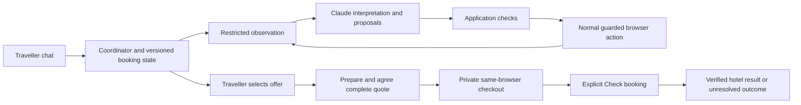
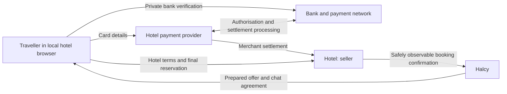

# Halcy hotel booking assistant — design document draft

Working draft, 2026-10-06. This is the initial submission narrative and information source for an approximately four-page design document, with diagrams. It consolidates the agreed design, not a certification that all flows work. Supporting detail lives in the linked documents; the evidence section must be refreshed after the final human-assisted booking run.

## 1. What we are building

Halcy turns a group-chat request into a direct booking with a hotel. It interprets the stay, searches the hotel's website, presents suitable rooms, prepares the traveller's choice and explains the full offer. The traveller completes private payment and the final reservation submission in the same browser. Halcy then checks the hotel's confirmation and reports the result.

The hotel is always the seller and payment recipient. Halcy does not collect payment, become the merchant, or manage refunds. The endpoint is a verified hotel booking communicated to the traveller, or an honest unresolved outcome. Amendments and cancellations of confirmed bookings are outside this exercise.

For “second full weekend of next month, river view if possible, cancellable, no breakfast”, the assistant resolves absolute dates, treats cancellation as a hard requirement and river view as a preference, and excludes unwanted breakfast. Occupancy comes from the group when available; otherwise it asks, treating a bare count as adults. The prototype assumes a shared stay and does not silently split the party. Rules come from the request: non-refundable rates remain valid for travellers who did not require flexibility.

The mobile-width chat is the entry point. The local visible hotel browser demonstrates the same-session handoff; it is not yet a production mobile-browser integration. We use only the mock hotel for automated booking tests. Unfamiliar-site support is an explicit design and evaluation target, not something established by succeeding on one mock.

## 2. Architecture and execution

The TypeScript chat server, booking coordinator and Playwright browser controller run locally. Claude is accessed through Anthropic's API. The coordinator holds request revisions, provisional offers, the selected room/rate, any accepted exceptions, the agreed quote, browser ownership and outcome evidence. UI cards and progress are views of that state.

The model receives permitted page text, fresh control IDs, the request and compact action history. It proposes a step; application code determines whether that step may run. Ordinary editable dates and unique observed date options can use deterministic helpers. Every action consumes its observation IDs and is followed by a fresh observation. Repeated no-change actions and short cycles stop rather than spending indefinitely.

Hotel pages are untrusted evidence. Their text cannot override application permissions. Runtime navigation uses visible pages and the supplied observe/act interface, not mock source, admin routes or a predetermined hotel selector sequence. The reviewer can independently verify a mock booking through the test oracle, but that capability is not exposed to the runtime agent.

Offer evidence must be tied to the selected room/rate. A cancellation paragraph elsewhere on the page cannot establish the chosen rate's policy. The quoted cancellation must retain its deadline and penalties; the guarantee claim must agree with its evidence; totals must include mandatory costs and reconcile with payment timing. Missing or contradictory evidence blocks a complete quote. Structured output alone does not make a plausible extraction true.

See [system design](system-design.md) for record contracts, the full sequence, state transitions and interruption diagrams.

## 3. Model choice, cost and mistakes

Use one configurable Claude model through the existing Anthropic account, with `claude-sonnet-5-5` as the configured baseline. Separate structured prompts handle request interpretation, page actions, offer extraction and confirmation. Start with direct API access and a provider adapter; do not add automatic model switching before measuring a baseline.

This keeps integration and debugging small within the exercise's eight-hour limit. The workload needs language understanding across unfamiliar labels and terms, while code is better suited to arithmetic, revisions, permissions and state transitions. A smaller model may reduce token price but lose that saving through extra steps, extraction failures or unnecessary handoffs. A larger model receives no broader authority and cannot invent missing hotel evidence.

The [dated model research](model-selection-spike.md) compares Claude, GPT and Gemini, explains direct access versus OpenRouter, and records illustrative prices. Its 120,000-input/12,000-output-token example estimates $0.36 for the selected baseline at the recorded rates. This is a planning example, not measured cost per successful booking. Track actual billable input/output/cache usage and retries. Runtime spend is limited to the brief's $50 allowance with a conservative stopping margin.

Measure accuracy, time and total spend per independently verified successful booking, including failed attempts. Compare time to first useful options, model calls, repeated actions and unnecessary human interventions. After a baseline, evaluate smaller models for narrow interpretation and a larger model for difficult pages using the same held-out scenarios. Escalation must not replay an uncertain hotel submission. Small local models may later help with message routing or simple edits; they are not the initial browser worker or the authority for payment permissions. Many small tasks need ordinary code rather than another model.

## 4. Keeping Halcy outside the payment path

The traveller's browser/provider fields handle card data; the bank handles verification. The hotel's provider processes payment and settlement under the hotel's arrangements. No funds, payment credentials or provider tokens pass through Halcy's coordinator or model. A guarantee/pay-at-hotel booking may involve no booking-time transfer while still authorising later charges. An inventory hold without financial obligation is different from a card authorisation hold, which reserves funds. [Payment boundary details and sources](payment-boundary.md).

Before private checkout, the coordinator disables observations and actions. The traveller uses the same browser session; a new link in another browser may lose the checkout. Chat remains open for questions about the previously reviewed quote, without inspecting the live page. Only an explicit Check booking action enables restricted read-only inspection. A redirect, a new tab or an absent iframe is not evidence of either success or safety.

The initial observer excludes subframes and foreign-origin pages, blocks sensitive top-level forms, and disables raw captures that could bypass those restrictions. Generic sensitive-surface classification is imperfect and some hotel engines will be unsupported. This design does not claim that iframe blindness eliminates liability: PCI scope, payment regulation and the actual service model need separate assessment. Collecting funds or credentials, initiating payments independently, or moving the browser into hosted infrastructure would require reassessing the boundary. The [payment document](payment-boundary.md#what-would-change-this-assessment) links PCI and FCA guidance.

There are distinct records of consent: a traveller's offer-specific exception, agreement to the complete Halcy quote, and final acceptance/submission in the hotel's flow. Halcy records the first two and the control handoff; the hotel/provider retain their own booking and payment records. None is interchangeable with proof that a reservation exists.

## 5. Traveller journey and recovery

Initial search presents all observed eligible room/rate options, ordered by evidenced preference fit and then comparable price, with the ordering explained in chat. Prices remain provisional until checkout reveals the complete total. The traveller chooses; the assistant does not silently book its favourite.

If nothing meets the hard constraints, show a separate set of useful near misses. Chips name hard conflicts, soft preference misses and unverified facts; colour only reinforces the text. Selecting a near miss opens a dialog repeating all known hard conflicts. Explicit continuation accepts them for that offer only, without changing the request or launching another search. Final quote agreement still follows.

Preparation fills ordinary guest details and removes unwanted optional extras. A conventional Continue to payment can proceed when its visible context gives no indication of a binding action. Requiring explicit no-obligation wording created an unnecessary handoff on the mock; we deliberately accept contextual inference for recognisable preparation. Conflicting/action-specific commitment language still blocks. Every identified binding submission and payment action belongs to the traveller. This trade-off needs reevaluation through real-site research.

Before agreement, show room/rate, dates, occupancy, inclusions, cancellation deadline and penalties, full total/currency/taxes, payment timing, guarantee and hotel recipient. Recheck before handoff. Material changes invalidate agreement and require a complete revised quote.

| Failure | Desired behaviour |
| --- | --- |
| Chosen room unavailable | Mark old offer unavailable; show saved alternatives nearest its comparable price, or announce a new search; traveller chooses again |
| Price/terms changed | Identify the change, revalidate constraints and request agreement to a complete new quote |
| Card declined / bank challenge | Traveller retries with the hotel; agent remains blind and needs outcome rather than bank-error diagnostics |
| Network or stale-control error | Bounded retry with fresh observation; no blind repeat of a possible submission |
| Payment approved without hotel confirmation | Preserve outcome-unknown; no automatic replacement or claim of success |
| Traveller quiet / hold expires | Let the hold expire; inspect the existing outcome on return rather than infer failure from time |
| Login or identity check | Private human assistance; specialised support deferred |

X/Stop or an explicit text stop ends the active operation and clears its loaders, keeping conversation history. Edits during search/preparation revoke old work and begin a revised search. Operation revisions prevent late model results or stale cards acting on the old request.

During private checkout, a requested change opens a submission-status dialog. “Not submitted” allows a revised search; “Submitted / not sure” requests restricted verification first; “Keep current checkout” dismisses the change. Asking whether payment happened would be insufficient for deferred-payment bookings. Stop assistance does not cancel a reservation. Confirmation ends the task; confirmed-booking modifications remain out of scope. [Full journey and edge cases](booking-journey.md).

## 6. How we know it works

Test three layers: deterministic policies/state transitions, browser integration with controlled page variants, and repeated chat-driven mock bookings with the human completing private checkout. Verify the actual hotel reference against the reviewer oracle. Scripted preparation reaching checkout is not end-to-end confirmation.

The test matrix includes unavailable preferences and selections, no eligible offer, near-miss exceptions, unwanted extras, taxes/repricing, misleading commitment wording, swapped rate terms, date controls, stale approvals, stop/edit races, declines, bank verification, expired holds and payment approval without a booking. Vary wording, layout and order to expose mock-specific assumptions. Check that private-chat questions never restore browser observation.

Report verified completion rate, quote/constraint accuracy, false confirmations, unintended commitments, sensitive-data exposure, recovery success, median/p95 automation time and spend per verified success. Any false confirmation, sensitive leakage or unauthorised commitment is a release blocker; zero observed failures in a small sample is not a safety guarantee. Separate human waiting from automated latency and report sample size and failure causes.

**Evidence at drafting:** the [validation record](validation-stage-one.md#stage-two-results-to-date) reports typecheck, 30 focused checks, scripted preparation and one live Claude chat run in which the traveller agreed to the full quote and completed private mock checkout. The reviewer-only oracle independently confirmed that reservation. The running chat's older confirmation matcher produced a false negative; the revised local matcher recognised that actual receipt in isolation, but a fresh full chat-to-confirmation run using the updated process is pending. One verified mock reservation does not establish a measured success rate or unfamiliar-site reliability. Refresh the evidence again before submission.

The [closing note](closing-note.md) records deliberate omissions, uncertainties and next work. The [documentation index](README.md) maps every brief requirement to its source and lists the remaining submission artifacts, including AI logs, runtime evidence and API receipts.
