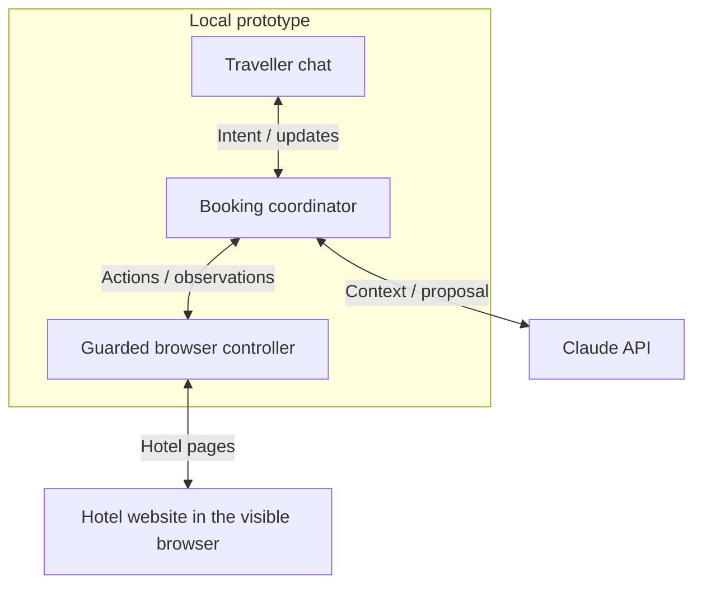
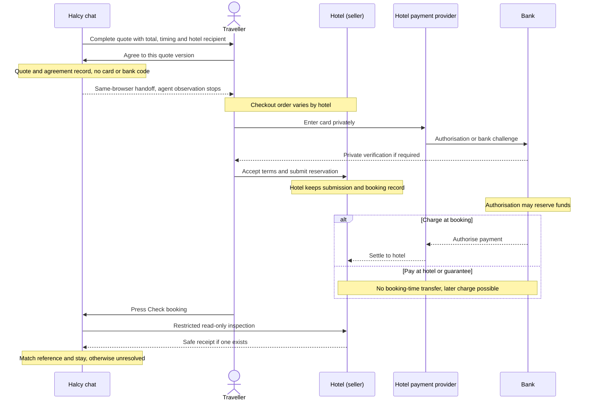
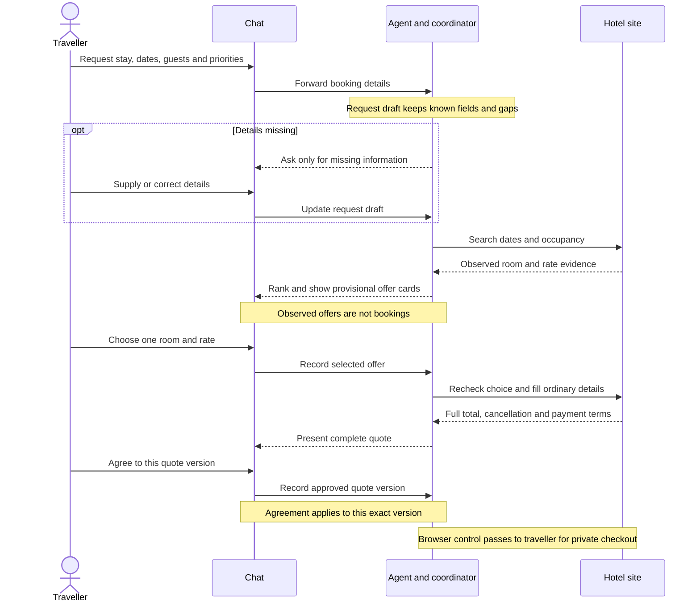

# Halcy Hotel Task - Tom Alner

## Where I started

I started by deciding what the agent and the traveller should each handle, and where the boundaries would lie between them. Payment was the clearest. I considered three more automated routes: storing a traveller's card in Halcy, having Halcy pay and invoice them, or letting them deposit credit for Halcy to spend. Each would change Halcy's role or the data it handles, and would need a separate legal and operational assessment. For this build I kept payment and final reservation submission with the traveller, directly in the hotel's browser. That also gives the hotel its own record of the traveller accepting its terms.

The supplied starter already had a phone-width chat, Playwright browser plumbing, a model seam and a run log. Its original observer could read visible fields in every frame, including field values. My first implementation priority was therefore to restrict observation and define who controls the browser at each point. I then built the shortest complete journey: interpret the request, search, show choices, prepare the selected room, get agreement to the full terms, hand over private checkout, and verify the hotel's confirmation. My next focus was on the user journey: the chat's progress, room presentation and working states. Given Halcy's multiplayer and agentic nature, the group chat needs to serve as a readable record of what the agent has done and is currently doing.

I chose to show every **observed eligible** room/rate option and let the traveller select one. Even when a request leaves only one eligible option, presenting it gives the traveller a final choice and highlights any unmet soft preferences. The agent ranks results by the request's stated priorities, such as river view first and then the nicest evidenced room, and labels missing facts and provisional prices. This keeps the final preference judgement with the traveller without pretending the agent has seen every room in the hotel's inventory. A cancellable rate is a hard requirement in the example request; river view is a preference; breakfast is excluded.

## What runs, and which decisions use a model

The prototype runs a TypeScript chat server, booking coordinator and visible Playwright-controlled Chromium browser locally. One configurable Claude model (`claude-sonnet-5-5` in the tested run) uses separate structured prompts for request interpretation, next browser action and offer extraction. The coordinator owns the request revision, observed offers, selected offer, accepted exceptions, quote and agreement version, browser control, and outcome. The model proposes; application code checks the proposal before an action runs. This diagram shows the components and their boundaries; the booking stages appear in the journey diagram below.

At the start, the model resolves relative dates, extracts requirements and keeps details supplied across multiple chat messages. The coordinator asks only for missing essentials. On the site, each proposed action must refer to a control in the current restricted observation; the next step gets a fresh observation. Code handles date-field checks, arithmetic, permissions, revisions, quote validation and repeated-action limits. Hotel page text is evidence, never an instruction to the agent. During private checkout, the coordinator suspends the browser controller's observation and action path until the traveller explicitly asks for a restricted booking check.

I used one model initially to keep integration and debugging manageable within the exercise. Unfamiliar hotel labels and terms call for language understanding, while another model would not make a missing price or policy safe to invent. A wrong action is contained by current-control IDs and commitment checks; a wrong extraction is tested against the selected rate and current quote evidence. For example, a cancellation sentence from another rate cannot support the chosen offer. Missing or contradictory room, tax, cancellation, payment-timing or recipient evidence prevents a complete quote.

A live confirmed run used 18 model calls and about **$0.193 of inference**. That is one observation, not a dependable cost per successful booking. I would compare verified completion, quote accuracy, false confirmations, time to useful options, repeated actions, human handoffs and **total spend divided by verified bookings**, counting failed attempts. Only then would I test a cheaper model for narrow tasks or escalation on difficult pages. I conducted [model research](model-selection-spike.md) which records the dated provider and price comparison; it does not substitute for measured runs.

With more time/resources I would likely conduct some model evaluations for each major agentic stage in the process. To do this, I'd run each stage with the most intelligent models to act as a baseline, then run the same stage with cheaper models and compare the results. I would also consider using a separate model for each stage, as the requirements for each stage are different. For example, the request interpretation stage requires understanding natural language and extracting relevant information, while the offer extraction stage requires understanding the structure of the hotel website and extracting relevant information from it. For this prototype stage though, I felt there were more worthwhile uses of time.

## Payment, agreement and the handoff

The traveller books with the hotel. The hotel is the seller and payment recipient, including for a rate where nothing is charged at booking. For a pay-now rate, the hotel's provider processes the stated booking-time charge; for pay-at-hotel, the traveller pays later under the stated terms. A card guarantee or no-show clause can still create an obligation. The sequence separates agreement, private card entry, payment timing and confirmation.

Before the traveller enters payment details, the coordinator transfers control of the **same browser session** and disables agent observation and actions. The observer excludes subframes and foreign-origin pages, blocks sensitive main-frame forms, and does not take raw screenshots or traces that would bypass those restrictions. Card fields and bank codes stay out of model observations and run logs. Chat remains open for questions answered from the already reviewed quote. The traveller later presses **Check booking** to permit limited, read-only inspection; this does not restore general browser control to the agent.

There are three distinct records: acceptance of an exception for one offer, agreement in chat to one complete quote version, and the traveller's final submission and acceptance in the hotel flow. Halcy logs the first two with their terms and revisions; the hotel and its provider keep the submission and payment records. Before chat agreement I show the room and rate, dates and guests, cancellation deadline and penalty, inclusions, full total and mandatory taxes, amount due now and later, guarantee terms, and the hotel as recipient. I recheck the quote before handoff and ask again when material terms change. Chat agreement is not proof of a booking; the agent requires a labelled hotel reference and matching stay details after checkout.

I allow a conventional guest-details **Continue to payment** step when its visible context does not indicate that the click books, charges or authorises payment. Requiring an explicit no-obligation disclaimer at every step blocked ordinary preparation on the mock. Any ambiguous or visibly binding action is passed onto the traveller. This contextual judgement is one of the choices I would most want to test on unfamiliar sites.

## User journey and failure modes

This sequence tracks how the **booking information** moves through chat and the hotel site. The request starts as a draft, observed offers remain provisional, and agreement applies to one complete quote version. The payment diagram above picks up after the private handoff.

With sufficient information, the agent takes control of the browser window and enters a 'working state'. During this time, the user can halt the agent via text or buttons in the chat interface. Once the agent has retrieved results, it presents the room options as cards forming a carousel, ordered by the priorities in the original request; each gives the observed price basis, dates, guests and known terms, and marks unknowns. A near miss appears separately with its hard conflicts. Selecting it requires an offer-specific exception, then the full quote agreement still follows. A chosen room that sells out is marked unavailable; the traveller chooses from saved alternatives or sees a new search announced. Buttons disable while a choice is submitted, and decided cards collapse into a readable history. Stop cancels assistance, not a hotel reservation.

If the final checkout terms differ from the agreed quote, the agent presents a complete revised quote. The traveller can accept or reject the new terms before checkout continues. Once the traveller controls private checkout, the agent cannot infer payment success or failure. The traveller presses **Check booking** to permit restricted inspection; the agent then checks the hotel reference and stay details and reports the outcome in chat. It cannot diagnose a private card or bank failure. A matching hotel receipt ends the journey with the booking reference and verified stay details; without one, the outcome remains unresolved.

| What changes                                                  | Agent response and traveller experience                                                                  |
| ------------------------------------------------------------- | -------------------------------------------------------------------------------------------------------- |
| No eligible room, or the chosen room disappears               | Show labelled near misses or observed alternatives; preserve hard requirements and ask for a new choice. |
| Tax, price, payment timing or cancellation terms change       | Invalidate the old agreement, explain the difference and present a complete new quote.                   |
| Card decline, bank challenge or traveller absence             | Leave checkout with the traveller; do not read private fields or infer failure from an expiring hold.    |
| Action timeout or uncertain submission                        | Inspect the existing state when permitted; do not repeat a possibly binding action.                      |
| Payment appears approved but no matching hotel receipt exists | Report an unresolved outcome and prevent an automatic second booking.                                    |

These states matter because the chat is shared and persistent: later readers need to distinguish a provisional option, an agreed quote, a private checkout in progress and an actual confirmation.

## How I would know it works

Before launch I would use held-out hotel layouts and wording, varied date widgets, swapped rate terms, tax changes, hostile page instructions, declines, expired holds and interrupted sessions. I would report sample sizes, verified completion and recovery rates, quote and constraint errors, false confirmations, unintended commitments, sensitive-data exposure, median and tail automation time, and spend per verified booking. False confirmation, sensitive leakage or an unauthorised commitment would block release even if the average completion rate looked good. The current implementation also contains a small generated test suite for the coordinator and offer ranking, and a smoke test for the full flow.

I also wanted to know what would serve as common blockers in extending to unfamiliar hotels. Thus, I tasked an agent with exploring a range of real and other mock hotel sites. My agent struggled with recognising date and guest pickers as inputs on several sites or found an input to be outside of its permitted actions. To generalise better the agent needs stronger ways to identify each stage from page structures without weakening its commitment and payment safeguards.
