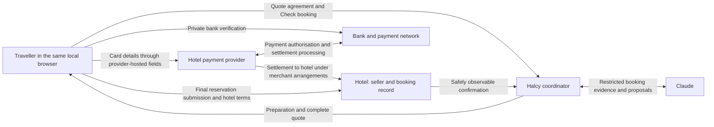

# Payment, observation and agreement boundaries

Design position, 2026-10-06. Halcy helps prepare a direct hotel booking. The hotel is the seller and contractual counterparty; the traveller submits the reservation and completes payment with the hotel's provider. This document explains the technical separation and its limits, rather than asserting regulatory exemption.

## Who handles what

Money does not pass through Halcy. Before a charge, funds remain with the traveller's financial institution; an authorisation can reserve available funds without settlement. The hotel's provider and payment network process charges and settlement under their merchant arrangements. For pay-at-hotel/guarantee rates, no booking-time transfer may occur, but later or no-show charges may be authorised. The exact settlement schedule is provider-specific and not required for this prototype. See [Stripe's authorisation-hold explanation](https://stripe.com/resources/more/authorization-holds-explained).

The traveller's browser and provider-hosted fields necessarily handle card input. The bank handles its private verification. Halcy's coordinator, model observations and run logs must receive neither card fields nor bank codes, and must not receive payment tokens or raw provider responses. The hotel may receive provider references/receipt information according to its integration; Halcy is not on that path.

## Browser control is a separate permission

| Mode | Browser observation | Browser actions | Chat |
| --- | --- | --- | --- |
| Agent preparation | Restricted allowed documents only | Guarded preparatory actions | Requests, choices, edits and Stop |
| Traveller control | None | None by agent | Questions answered from reviewed quote; change requests routed to a dialog |
| Explicit verification | Restricted read-only inspection | No booking or payment submission | Report confirmation, discrepancy or uncertainty |
| Stopped | None until a new permitted control transition | None | History remains; no implication of cancellation |

Exclude sensitive surfaces before extracting data, not after sending them to the model. The initial design excludes subframes and foreign-origin pages, blocks sensitive top-level forms, and disables raw screenshots/traces/network/console capture that could bypass the policy. A new tab or redirect after payment does not prove that safe inspection is possible. Check booking grants limited inspection, not general control. This conservative coverage will reject some embedded booking engines; arbitrary-site isolation remains an unresolved engineering risk.

## Preparation versus obligation

Recognisable guest-details continuation is allowed by contextual inference when visible evidence does not indicate a binding action. An explicit “nothing will be booked” disclaimer is not required. That is a deliberate prototype usability trade-off to revisit in real-site research, not a guarantee about hidden site behaviour.

An expiring room-inventory hold without financial obligation is preparation. A card authorisation hold is payment. “Nothing charged now”, absent card fields, or a pay-at-hotel rate cannot by themselves prove the absence of a binding reservation. An action-local statement such as “no reservation until you continue to payment” identifies that very action as the boundary. Conflicting evidence blocks it; every identified final binding submission remains human-controlled.

## Three different records of agreement

1. **Option exception:** the traveller knowingly accepts specific hard-constraint conflicts for one chosen offer. It is not permission to pay.
2. **Halcy quote agreement:** the traveller approves complete versioned terms in chat. Keep the proposal, evidence, timestamp/revision and explicit action. Invalidate agreement when material terms change.
3. **Hotel submission and payment authorisation:** the traveller accepts hotel terms and submits in the private hotel/provider flow. The hotel, provider and bank retain their own records. Halcy's chat audit does not replace them.

A hotel reference and matching details establish the booking outcome for the assistant. A payment-success message, user claim or button click alone does not. A stopped run cannot be represented as a cancelled reservation.

## What would change this assessment

Collecting or forwarding payment credentials, holding customer funds, becoming merchant of record, or initiating payments independently would materially change the activity and require a new assessment. Hosting or streaming the browser could also put sensitive content into Halcy-operated infrastructure even if the model never sees it. Blindness to an iframe alone does not settle liability or regulatory scope.

PCI's [iframe FAQ](https://www.pcisecuritystandards.org/faqs/1438/) concerns merchant SAQ eligibility and the source of payment-page elements; it is not a general exemption for a booking assistant. The FCA's [payment-services exclusions guidance](https://handbook.fca.org.uk/handbook/perg15/perg15s5) addresses the actual activity and applicable exclusions. These are relevant references, not a legal determination for Halcy or every jurisdiction. Production deployment needs a review of the actual service, contracts and data path.
