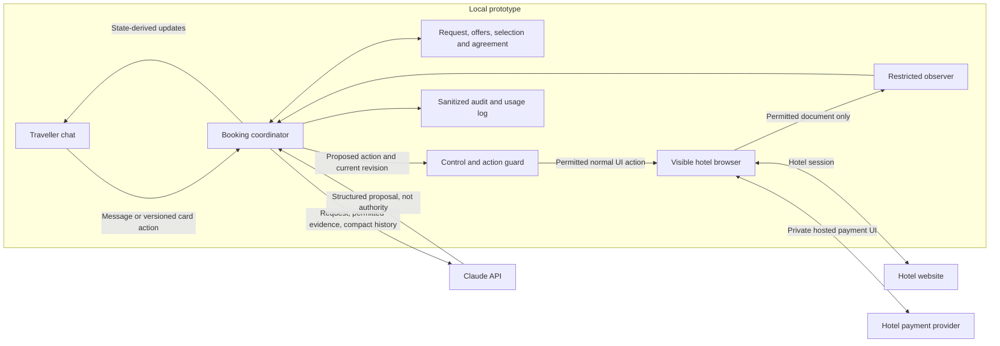
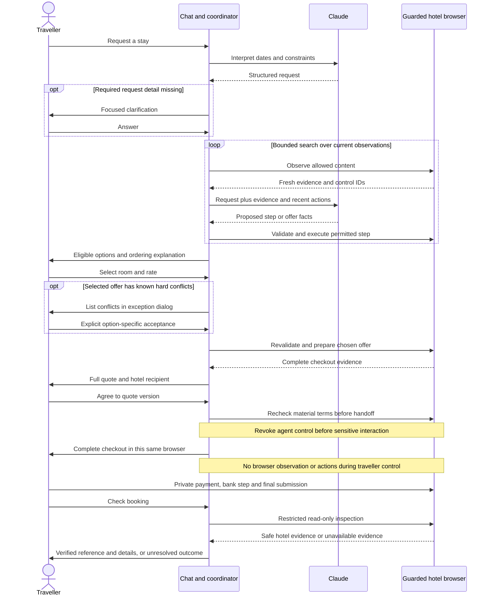
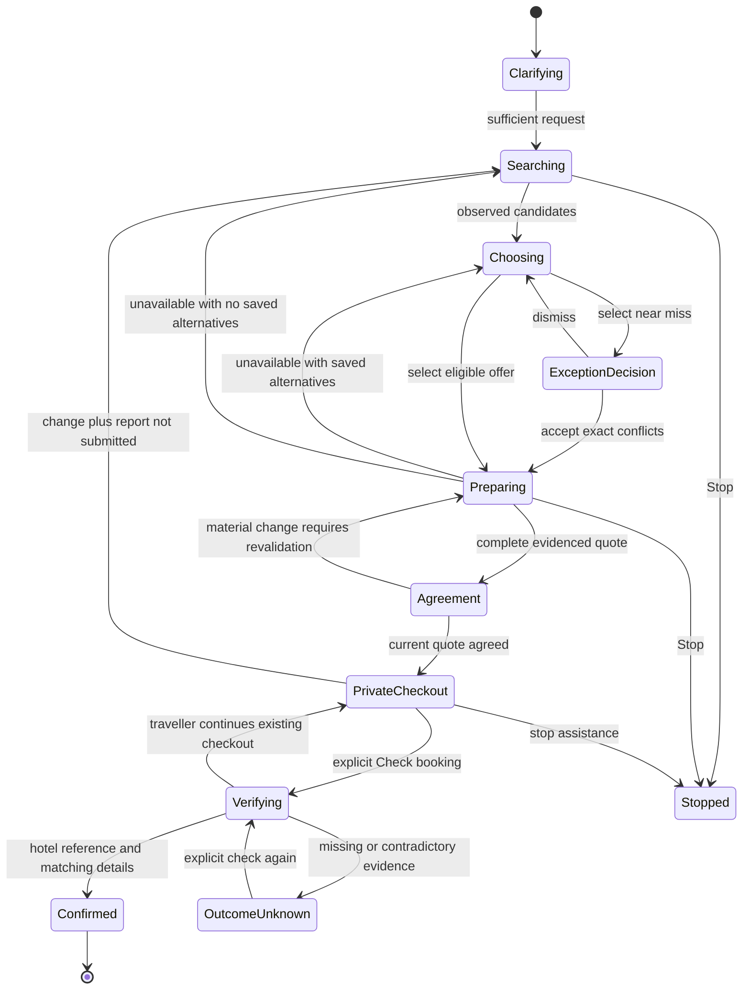

# System design and data flow

Agreed design, 2026-10-06. These diagrams describe responsibilities and permitted transitions; they are not proof of implementation completeness. See [architecture decisions](architecture-stage-one.md), [journey](booking-journey.md), and [validation evidence](validation-stage-one.md). Mermaid blocks can be rendered or redrawn for the final submission.

## Components and trust boundaries



The browser includes private surfaces which the observer must exclude before extraction. The diagram does not grant the observer access to every browser document. While control belongs to the traveller, the entire observe/act loop is paused. Browser cookies and payment tokens remain outside the model and application logs. Ordinary lead-guest details can be used for form preparation; they still require normal personal-data handling.

The model interprets requests, identifies unfamiliar controls, extracts offer evidence, and proposes actions. Code owns permissions, cancellation/revisions, arithmetic, state transitions, agreement, retries and budgets. Hotel text is untrusted input, including any text purporting to instruct the agent or grant it permissions.

## Authoritative records

These are logical records, not a prescribed database schema. The prototype is in memory; persistence and crash recovery remain future work.

| Record | Contents and purpose |
| --- | --- |
| Request | Hotel mention and resolved site, absolute dates, occupancy, hard constraints, soft preferences, exclusions, ordered ranking priorities and unresolved fields; monotonically increasing revision |
| Operation | Operation ID/revision, current stage, cancellation signal and permitted control owner; separates old asynchronous work from current intent |
| Observation | Fresh ID, allowed URL/document, permitted visible facts and currently actionable controls; never reusable across actions/navigation |
| Offer candidate | Room/rate identity, observation/time, price basis and completeness, constraint evidence and availability status; provisional until revalidated |
| Selection | Traveller-selected offer tied to request revision; no automatic substitution on failure |
| Exception acceptance | Exact known conflicts accepted for that offer/request revision, plus the explicit traveller action; does not change the original request |
| Quote | Versioned complete terms, currency/total, tax basis, now/later amounts, guarantee, recipient, dates and occupancy; field-level evidence bound to the selected offer |
| Agreement | Explicit acceptance of a particular quote version and its material terms; never inferred from selection or a near-miss exception |
| Outcome | Not submitted, possibly submitted, verified confirmed, established failure, or unresolved; retain whether evidence is hotel-observed or traveller-reported |

Card actions carry sufficient identity to reject an old selection, exception or approval. The UI can keep stale cards as history, but the server must reject their controls even if a client displays them incorrectly.

## Booking sequence



If the recheck finds a material change, return to a new complete quote and fresh agreement before handoff. A redirect, new tab or payment-success screen does not substitute for matching hotel confirmation. Unsupported tabs/frames remain restricted even after Check booking.

## State transitions and recovery



This diagram omits some edit/stop edges for readability; those controls apply across stages. Stopped means assistance ended, not that a reservation was cancelled. OutcomeUnknown has no automatic replacement-booking edge. A process restart must not erase that uncertainty conceptually, even though durable reconciliation is not implemented in this prototype.

## Interruptions and asynchronous work

```mermaid
sequenceDiagram
  actor T as Traveller
  participant C as Coordinator
  participant M as Pending model call
  participant W as Browser action queue
  T->>C: Stop or edit request
  C->>C: Revoke operation revision and old card actions
  C->>W: Prevent further old-operation actions
  C-->>T: Clear active loaders; preserve history
  M-->>C: Late response for old revision
  C->>C: Discard response and its proposed actions
  opt Browser action was already dispatched
    C->>C: Mark outcome pending; retain session
    C->>W: Inspect only when control permits
  end
  opt Edit before private checkout, outcome safe
    C->>C: Apply edit; preserve unchanged fields
    C-->>T: Begin revised search
  end
```

Cancellation cannot undo a request already received by the hotel. Revisions must be checked before dispatch and after awaited work, and browser mutations must be serialized. An old model call must not publish a new actionable card, clear a newer operation's loader, or regain browser control. Abort transport where possible; discard late results regardless.

During private checkout, questions use the stored quote. Changes save pending edits and open the submission-status dialog in [the journey](booking-journey.md#chat-during-private-checkout). A message, timer or Stop click does not grant browser inspection permission.

## Evidence and audit

Record request and operation revisions, offer selection, accepted exceptions, quote versions, explicit agreement, control changes, safe action outcomes, hotel confirmation reference and model usage. Retain enough sanitized evidence to explain a quote without logging raw browser captures. Cancellation completeness and guarantee support need semantic checks: occurrence of an excerpt somewhere on a page is insufficient.

Keep card fields, bank codes, provider tokens, session secrets and raw payment responses out of observations and logs. Disable raw screenshots, traces and console/network capture that could bypass these exclusions. Chat remains an input channel: do not solicit sensitive payment details there; handling unsolicited sensitive text is an additional production privacy requirement, not something browser isolation solves.

Log observed facts separately from model interpretations and traveller reports. Hotel confirmation proves a booking outcome; chat agreement records which proposal was approved; the hotel and its provider retain their own final submission and payment records. The reviewer-only mock booking verifier is outside the runtime trust boundary.
